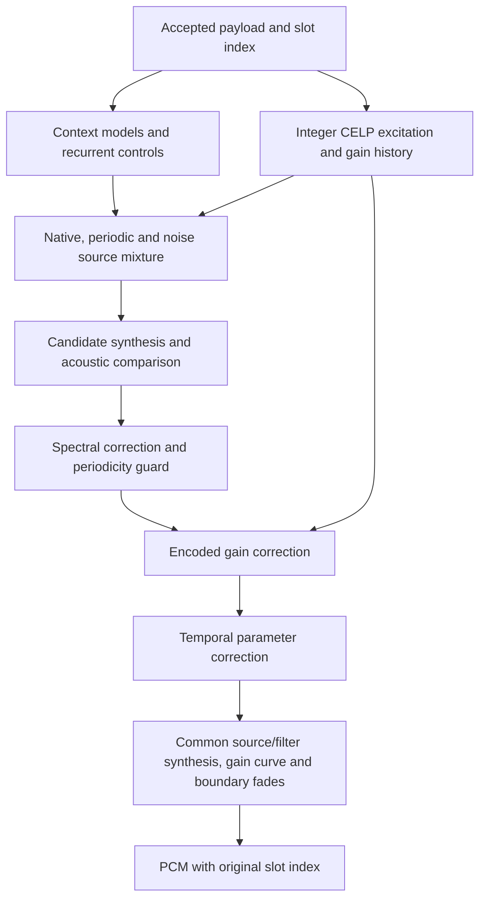

# jr_conventional_voice 1.3.0

[English](README.md) | 日本語

純 Rust による改良型RL-CELP（Modified RL-CELP）の音声合成ライブラリです。
受理済みの CELP ペイロードとスロット番号を受け取り、固定の学習済みモデルと、状態を保持する信号処理を組み合わせて PCM を生成します。
音量レベル・周期性・ピッチ・スペクトル包絡を推定し、複数の候補波形を合成して、
隣接フレームを含む音響目標に最も合う候補を選びます。

## 入出力と処理単位

復調、同期、チャネル復号、FEC・CRC に基づく受理判定は、受信側でこのクレートを呼び出す前に
行います。このクレートへの入力は、有効な音声ペイロード、または欠落・非音声スロットの通知と、
`u32` 型のスロット番号です。

| 項目 | 形式 |
|---|---|
| 入力フレーム | 158ビットを各バイトの下位ビットから順に20バイトへ格納。バイト19の上位2ビットは0 |
| フレームの時間長 | 40 ms |
| 出力フレーム | 8 kHz・モノラルの `i16` 型320サンプルと、元のスロット番号 |
| スペクトルの処理単位 | 前半・後半の20 msごとに独立したスペクトル包絡 |
| 励振と音量の処理単位 | 10 ms・80サンプルのブロック4個 |
| 連続入力の先読み | 合計7フレーム・280 ms |

20 msと10 msは、40 msの入力フレーム内で音声を合成するための処理単位です。
これらの単位間でも、連続するフレーム間でも状態を引き継ぎます。モデルの特徴抽出で用いる
ビットのグループ分けや符号語の解釈は、この実装の処理を表すものであり、改良型RL-CELPの規範的な
ビット割当全体を確定するものではありません。

## 全体の動作原理

音声を、**励振信号（音源）**と**スペクトル包絡**に分けて扱います。励振信号は周期的な
パルスとノイズの性質を決め、スペクトル包絡はその周波数成分を整えます。音量とピッチの
制御値が、時間に沿った音の変化を決めます。固定の学習済みモデルがペイロードと前後の文脈から
これらの制御値と音響目標を推定し、合成処理が実際の波形を生成します。



モデル係数はすべてクレートに組み込まれています。推論には固定テーブル、線形変換、
小規模なニューラルネットワーク、再帰状態を使います。一部の重みはスケール係数付きの
量子化整数で保存し、信号処理やモデルの中間値は主に `f32` で計算します。復号中にモデルの
重みは変化せず、入力に応じてストリームごとの履歴が更新されます。

### 1. 特徴抽出と合成パラメータの予測

[`predictor.rs`](src/predictor.rs) は158ビットを展開し、フレームの前半・後半に対応する
79ビットずつの特徴グループに並べ替えます。テーブル参照とピッチに関するフィールドから
40要素の要約特徴を作り、各入力ビットを符号付きの値に変換した158要素を加えて、
**198要素の特徴レコード**にします。

線形予測器は、過去3フレームから未来3フレームまでの計7フレームを参照します。
小規模な多層ネットワークが、近傍の特徴レコードからスペクトルと音量の推定を補正します。
さらに、**64状態の GRU（ゲート付き再帰ユニット）**が、それまでの予測の情報を引き継ぎ、
残差として加える調整量を求めます。反射係数には範囲制限を設け、スペクトル包絡を表す
ケプストラムへ変換します。その後、近傍ブロックやペイロードのカテゴリを用いて、ピッチを
安定化し、スペクトル形状とピッチに範囲を制限した補正を加えます。

結果は、内部の**82要素の制御ベクトル**として扱います。

| 制御値 | 用途 |
|---|---|
| 音量レベル4個 | 10 msブロックごとの目標音量 |
| フレーム全体の有声性と周期 | 校正・補正のための文脈 |
| 32要素のケプストラム2組 | 前半・後半の20 msごとのスペクトル包絡 |
| 周期性の制御値4個 | 10 msブロックごとのパルスとノイズの混合比の制御 |
| ピッチ周期4個 | サンプル単位の励振周期。20〜160サンプルに制限 |
| 追加の音量傾斜4個 | ブロック内のゲイン変化への入力。この処理経路では0で初期化 |

区間の端や EOF で前後の文脈が足りない場合は、最も近い有効な特徴レコードで補います。
そのため、短い通話も文脈がそろうまで待たずに `flush()` で出力できます。

### 2. ゲインとスペクトル形状の補正

[`correction.rs`](src/correction.rs) は、ペイロードのカテゴリと直近の履歴を用いて、
予測された制御値を調整します。ゲイン補正では、符号に応じた値、直近4個のゲインカテゴリ、
音響制御値を組み合わせます。ゲート処理により小音量部分での補正を弱め、高い音量に近い領域では
正方向のゲイン補正を制限します。

スペクトル補正では、符号に応じたテーブル、直近のスペクトルカテゴリ、小規模な量子化
ニューラルネットワークを組み合わせます。補正量は係数自体と周波数領域への影響の両面で制限し、
スペクトル包絡へ加えます。これらの処理は、波形を生成する前の合成パラメータに作用します。

### 3. 励振信号とその履歴の復元

[`src/celp/`](src/celp/) は、[mcelp-codec](https://github.com/soltia48/mcelp-codec)
の実装の一部を流用・改変しています。主な対象は [`fixed_core/`](src/celp/fixed_core/) の
整数DSP処理とテーブルで、改良型RL-CELPのパラメータ解釈、ゲイン・スペクトルの状態管理と
組み合わせています。流用部分の著作権表記は Copyright (c) 2026 KIRISHIKI Yudai、
ライセンスはMITです。元の著作権表記とライセンス全文を
[`src/celp/LICENSE`](src/celp/LICENSE) に保持しています。

[`celp/`](src/celp/) はフレーム内の2組のパラメータを解釈し、
整数演算のCELP処理を実行します。適応コードブックのピッチ履歴と疎な革新パルスから、
80サンプルの励振を4ブロック生成します。スペクトル表の参照と補間、予測ゲイン、
飽和演算、合成フィルタの状態はフレームをまたいで継続します。受信再開時には、
対数ゲイン表の平均値でゲイン履歴を初期化します。

この復元波形と内部のゲイン量を後段モデルの観測量として使います。割当が未確定の
ビットについての解釈は実装上の仮説であり、規格として確定したものではありません。
[`excitation.rs`](src/excitation.rs) は10次予測フィルタによる励振の白色化と
ブロックごとの正規化を行います。さらに、現在と過去の励振から周期的な音源を作り、
固定シードの雑音と合わせて3種類の音源を用意します。復号時に参照音声は使いません。

### 4. 音源の混合と合成候補の選択

[`source_features.rs`](src/source_features.rs) はペイロードと物理的な特徴量の履歴を
20 msごとに570要素へまとめます。復元波形の特徴、合成制御値、音源同士の関係を加えた
**633要素**を **633→256→128→40** のニューラルネットワークへ入力し、
スペクトル・音量の補正と音源混合比の調整量を求めます。混合比を正規化・平滑化し、
混合後のブロック電力も正規化します。

提案した音源と通常のパルス・雑音音源の試行波形を比較します。提案側の周期性が弱く、
通常側に十分強い周期性があるフレームは、通常側の制御値と音源を使います。
この規則は音声にもチャイムにも共通です。

[`planner.rs`](src/planner.rs) は、
[`plan_features.rs`](src/plan_features.rs) と [`plan_target.rs`](src/plan_target.rs) が
220要素の特徴から予測した音響目標を使います。目標にはブロック音量、帯域ごとの
スペクトル形状、周期性、ピッチ誤差の費用が含まれます。現在フレームの候補を3個、
各候補の状態から次フレームを3個ずつ、計9個試行します。明示的な励振が与えられた
ブロックでは候補間で音源が共通になるため、異なる選択が同じ波形を生むこともあります。
確定するのは選ばれた現在フレームの状態だけです。

[`plan_acoustics.rs`](src/plan_acoustics.rs) が実際の試行PCMを測定します。
20〜160サンプル遅延の相関は整数の積和から求め、Hann窓を適用したスペクトルの帯域値、
4ブロックのエネルギー、飽和も評価します。履歴があれば、重なり合う80 ms窓の評価も加えます。
現在の費用と最良の次フレーム費用の和を比較し、所定の差がなければ標準候補を維持します。
区間先頭は必ず標準候補です。通常音源の試行と、選択した音源の合成は独立した状態を持ち、
それぞれ1フレーム先を参照します。

### 5. 最終合成前のスペクトル・ゲイン補正

選択波形と整数CELP波形の特徴、および受信開始からの経過量を追加した**679要素**を、
**679→384→192→34** のネットワークへ入力し、スペクトル形状を補正します。
独立した試行合成で、元の波形が保っていた周期性を補正が失わせていないか調べます。
失われる場合はそのフレームの補正前の制御値を使います。試行合成自身の履歴は継続します。

次に、フレーム全体の音量を元に戻す処理を無効にして基準波形を合成します。その実測音量と
要求音量との差、要求音量、整数CELPのゲイン履歴を追加し、**707要素**の観測を作ります。
末尾137要素を固定の線形ゲインモデルへ入力し、20 ms内の2ブロックの補正量を推定して
半分の強さで適用します。

時間方向の補正モデルは707要素を128要素に圧縮し、過去4個・現在1個・未来2個の
20 ms区間をまとめて **896→256→128→34** のネットワークへ入力します。
受信区間の外側は最も近い区間の値で補います。スペクトルとゲインの補正は半分の強さで
適用し、スペクトルは係数と周波数応答の両方で変化を制限します。最終的なゲイン変化は
±12 dB、目標音量は−120〜−3 dBに制限します。

[`synthesis_parameters.rs`](src/synthesis_parameters.rs) は80サンプル間隔のゲイン節点を
余弦曲線で補間します。隣接区間の節点は同じ連続受信区間に限って使います。
このゲイン曲線はピーク制限より前の合成処理内で適用します。フレーム全体の音量を
元に戻す処理は無効にし、推定した補正を打ち消さないようにします。

### 6. 音声とチャイムに共通の波形合成

[`vocoder.rs`](src/vocoder.rs) は2つのケプストラム包絡から、正規化した
最小位相の128タップ応答を求め、選択した励振をフィルタに通します。励振、スペクトルの
平滑化、位相、電力推定の履歴をフレーム間で保持します。ブロック内のゲイン傾斜、
電力正規化、推定したゲイン曲線、ピーク制限、最近接偶数丸めを経てPCM16を出力します。
受信区間の境界には80サンプルのフェードを使います。

音声、旅客一斉放送のチャイム、通話チャネルのチャイムはすべて同じ経路で復号します。
チャイム専用の判定器、旋律生成器、正弦波バンク、音声とのクロスフェードはありません。
モデル係数は復号中には変化せず、変化するのは各ストリームの履歴です。係数と表は
crateに含まれており、推論にGPUや外部のモデルサービスは必要ありません。

## 先読み・欠落・ストリーム状態

基礎予測器が未来3フレーム、2段の音源選択がそれぞれ1フレーム、時間方向の補正が1フレーム、
ゲイン補間が1フレームを参照します。合計は**未来7フレーム・280 ms**です。
番号0から連続入力する場合、番号7を受け取ると番号0の出力が得られます。
この値はアルゴリズム上の先読みであり、計算時間と再生バッファの遅延は別途加わります。

[`stream.rs`](src/stream.rs) は容量が一定のキューを持ちます。受信番号に欠落があれば、
前区間の残りを出力し、境界フェードを適用してから、予測器、コードブック、ゲイン、雑音、
フィルタ、候補選択、時間方向の補正の状態をすべてリセットします。欠落通知でも待機中の
処理を進めます。通常の入力操作で出力するのは最大1フレームです。`flush()` は先読みより
短い通話も含めて残りをすべて出力し、再度呼び出しても重複出力しません。
入力キューは8ペイロード、出力キューは16フレームで、通話時間に比例してメモリが増える
構成ではありません。

欠落スロットの代替PCMは生成しません。出力には元の番号が付くので、呼び出し側が無音や
再生時刻を管理できます。番号を振り直して受信を開始する場合は、新しい `Voice` または
`jr_voice_reset` を使います。独立した受信チャネルごとに状態を用意し、変更しない係数は
共有します。C ABI番号とフレーム表現は従来どおりです。

## API の使用方法

安全な Rust インターフェースは [`receiver::Voice`](src/receiver.rs) です。
有効・欠落の両スロットを通じて、入力番号を厳密に増加させてください。`push()` の後と
`flush()` の後は、`read()` で出力をすべて読み出します。未読の出力がある間は次の入力を
受理しません。不正なペイロードや番号順序のエラーではスロットを消費せず、内部の合成エラーが
発生した場合は、再初期化するまでデコーダの利用を停止します。

```rust
use jr_conventional_voice::receiver::{Output, Voice};

pub fn decode(
    slots: impl IntoIterator<Item = (u32, Option<[u8; 20]>)>,
) -> Result<Vec<Output>, String> {
    let mut voice = Voice::default();
    let mut output = Vec::new();
    for (index, payload) in slots {
        voice.push(index, payload)?;
        while let Some(frame) = voice.read() {
            output.push(frame);
        }
    }
    voice.flush()?;
    while let Some(frame) = voice.read() {
        output.push(frame);
    }
    Ok(output)
}
```

有効フレームは `Some(payload)`、不受理・非音声スロットは `None` として渡します。
各 `Output` には `index` と `pcm: [i16; 320]` が入ります。ストリーミング処理では、
ベクターにまとめず、出力が得られるたびに利用できます。

[C ヘッダー](include/jr_voice.h) は **ABI 2** を定義します。`jr_voice_process` で
ペイロードを、`jr_voice_advance` で欠落スロットを渡します。これらの呼び出しと
`jr_voice_flush` の後は、`jr_voice_read` で出力をすべて読み出してください。
読み出しが成功すると、元の番号と、640バイトのリトルエンディアン PCM を書き込みます。
同じハンドルへの操作は排他的に、順番に実行する必要があります。

| ストリーム操作の戻り値 | 意味 |
|---|---|
| `0` | 成功。`jr_voice_read` では読み出せる出力がないことを表す |
| `jr_voice_read` の `1` | 1フレームの出力をコピーした |
| `-1` | 不正な引数またはペイロード |
| `-2` | ストリーム状態または番号順序が不正 |
| `-3` | 未読の出力を先に読み出す必要がある |
| `-4` | 内部エラー。リセットが必要 |

`jr_voice_status` は、完了・失敗フラグ、フレーム数、処理時間を28バイトの構造体で返します。
`jr_voice_version()` は `1.3.0` を返します。Cargo のライブラリ出力形式は `rlib` であり、
ヘッダーにはエクスポートする C 関数の入口を記載しています。

## ソース構成とテスト

[`synthesis.rs`](src/synthesis.rs) が合成全体の進行を管理します。
[`synthesis_models.rs`](src/synthesis_models.rs) にモデルの読み込みと固定係数による推論処理があり、
モデルデータは [`src/models/`](src/models/) の `.bin` ファイルに収録しています。
[`models.rs`](src/models.rs) と [`model_bindings/`](src/model_bindings/) には、
予測・補正・音源選択のテーブルの型、次元、バイト位置を定義しています。
値はリトルエンディアンで格納し、コンパイル時に型付き配列へ変換します。
メモリアラインメントに依存する型変換を使わず、浮動小数点のビット列と量子化した整数値を
保持します。インデックスはホストのポインタ幅によらず32ビット符号なし整数で格納します。

音源・スペクトル・ゲイン・時間方向の推論に使うファイルには、名前と次元を持つ浮動小数点配列を
格納しています。これらは一度だけ読み込み、デコーダの各インスタンスで共有します。
CELPのパラメータテーブルは `celp_parameters.bin` に収録しています。
すべて `include_bytes!` で実行ファイルに埋め込むため、実行時に外部のモデルファイルは不要です。

前述の各ファイルで、特徴抽出、整数CELPの状態、音響評価、パラメータ補正、波形合成を分担しています。

```sh
cargo test -p jr_conventional_voice --locked
cargo clippy -p jr_conventional_voice --all-targets --locked -- -D warnings
```

テストのペイロードはメモリ上で生成します。ABIの入力検証と出力待ち、7フレームの先読み、
未来入力への依存範囲、連続する受信断、短い通話の末尾、状態の独立性、最大番号、
雑音の再現性、終端処理の重複防止を検証します。実際に収録した音声や無線データの
テスト用ファイルは同梱していません。これらはAPIと数値処理のテストです。
デコーダ内部の音響評価値は、聞き取りやすさを直接測定する指標ではありません。
