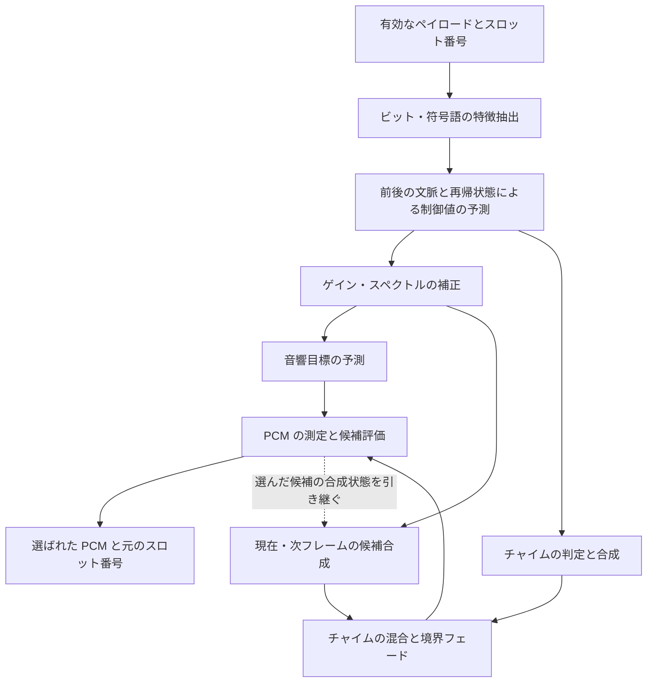

# jr_conventional_voice 1.2.0

[English](README.md) | 日本語

純 Rust による改良型RL-CELP（Modified RL-CELP）の音声合成ライブラリです。
受理済みの CELP ペイロードとスロット番号を受け取り、固定の学習済みモデルと、状態を保持する信号処理を組み合わせて PCM を生成します。
音量レベル・周期性・ピッチ・スペクトル包絡を推定し、複数の候補波形を合成して、
隣接フレームを含む音響目標に最も合う候補を選びます。

## 入出力と処理単位

復調、同期、チャネル復号、FEC・CRC に基づく受理判定は、受信側でこのクレートを呼び出す前に
行います。このクレートへの入力は、有効な音声ペイロード、または欠落・非音声スロットの通知と、
`u32` 型のスロット番号です。

| 項目 | 形式 |
|---|---|
| 入力フレーム | 158ビットを各バイトの下位ビットから順に20バイトへ格納。バイト19の上位2ビットは0 |
| フレームの時間長 | 40 ms |
| 出力フレーム | 8 kHz・モノラルの `i16` 型320サンプルと、元のスロット番号 |
| スペクトルの処理単位 | 前半・後半の20 msごとに独立したスペクトル包絡 |
| 励振と音量の処理単位 | 10 ms・80サンプルのブロック4個 |
| 連続入力の先読み | 合計4フレーム・160 ms |

20 msと10 msは、40 msの入力フレーム内で音声を合成するための処理単位です。
これらの単位間でも、連続するフレーム間でも状態を引き継ぎます。モデルの特徴抽出で用いる
ビットのグループ分けや符号語の解釈は、この実装の処理を表すものであり、改良型RL-CELPの規範的な
ビット割当全体を確定するものではありません。

## 全体の動作原理

音声を、**励振信号（音源）**と**スペクトル包絡**に分けて扱います。励振信号は周期的な
パルスとノイズの性質を決め、スペクトル包絡はその周波数成分を整えます。音量とピッチの
制御値が、時間に沿った音の変化を決めます。固定の学習済みモデルがペイロードと前後の文脈から
これらの制御値と音響目標を推定し、合成処理が実際の波形を生成します。



モデル係数はすべてクレートに組み込まれています。推論には固定テーブル、線形変換、
小規模なニューラルネットワーク、再帰状態を使います。一部の重みはスケール係数付きの
量子化整数で保存し、信号処理やモデルの中間値は主に `f32` で計算します。復号中にモデルの
重みは変化せず、入力に応じてストリームごとの履歴が更新されます。

### 1. 特徴抽出と合成パラメータの予測

[`predictor.rs`](src/predictor.rs) は158ビットを展開し、フレームの前半・後半に対応する
79ビットずつの特徴グループに並べ替えます。テーブル参照とピッチに関するフィールドから
40要素の要約特徴を作り、各入力ビットを符号付きの値に変換した158要素を加えて、
**198要素の特徴レコード**にします。

線形予測器は、過去3フレームから未来3フレームまでの計7フレームを参照します。
小規模な多層ネットワークが、近傍の特徴レコードからスペクトルと音量の推定を補正します。
さらに、**64状態の GRU（ゲート付き再帰ユニット）**が、それまでの予測の情報を引き継ぎ、
残差として加える調整量を求めます。反射係数には範囲制限を設け、スペクトル包絡を表す
ケプストラムへ変換します。その後、近傍ブロックやペイロードのカテゴリを用いて、ピッチを
安定化し、スペクトル形状とピッチに範囲を制限した補正を加えます。

結果は、内部の**82要素の制御ベクトル**として扱います。

| 制御値 | 用途 |
|---|---|
| 音量レベル4個 | 10 msブロックごとの目標音量 |
| フレーム全体の有声性と周期 | 校正・補正のための文脈 |
| 32要素のケプストラム2組 | 前半・後半の20 msごとのスペクトル包絡 |
| 周期性の制御値4個 | 10 msブロックごとのパルスとノイズの混合比の制御 |
| ピッチ周期4個 | サンプル単位の励振周期。20〜160サンプルに制限 |
| 追加の音量傾斜4個 | ブロック内のゲイン変化への入力。この処理経路では0で初期化 |

区間の端や EOF で前後の文脈が足りない場合は、最も近い有効な特徴レコードで補います。
そのため、短い通話も文脈がそろうまで待たずに `flush()` で出力できます。

### 2. ゲインとスペクトル形状の補正

[`correction.rs`](src/correction.rs) は、ペイロードのカテゴリと直近の履歴を用いて、
予測された制御値を調整します。ゲイン補正では、符号に応じた値、直近4個のゲインカテゴリ、
音響制御値を組み合わせます。ゲート処理により小音量部分での補正を弱め、高い音量に近い領域では
正方向のゲイン補正を制限します。

スペクトル補正では、符号に応じたテーブル、直近のスペクトルカテゴリ、小規模な量子化
ニューラルネットワークを組み合わせます。補正量は係数自体と周波数領域への影響の両面で制限し、
スペクトル包絡へ加えます。これらの処理は、波形を生成する前の合成パラメータに作用します。

### 3. 候補選択に使う音響目標の予測

[`plan_features.rs`](src/plan_features.rs) は、補正後の制御値とペイロードから、別の
**220要素の特徴ベクトル**を作ります。現在の制御値の要約、前フレームとの差、平滑化した履歴、
スペクトル・ゲインの特徴、符号語から求めた励振の要約を含みます。励振の要約には、
エネルギー、短い遅延での相関、パルスのクラス情報などを使います。

[`plan_target.rs`](src/plan_target.rs) は、合成後の PCM で得られるべき測定値を予測します。
目標には、4ブロックの音量、前半・後半それぞれ20帯域のスペクトルレベル、周期性、
ピッチが測定可能である度合いを含みます。ピッチについては分布を予測し、20〜160サンプルの
各遅延候補に誤差コストを与えます。累積分布を単調になるよう調整してから、ピッチ誤差の期待値へ
変換します。現在フレームの周期性目標には、小規模なニューラルネットワークによる補正も加えます。

目標は、現在の40 msフレームと、重なり合う2個の80 ms窓について求めます。
長い窓には過去の PCM も含め、フレーム境界をまたいだ連続性を評価します。目標はすべて、
ペイロードの特徴、制御値、デコーダの履歴から作られます。

### 4. 候補波形の合成

[`vocoder.rs`](src/vocoder.rs) は、80サンプルのブロック4個として波形を生成します。
ピッチ周期によって、位相を連続に保ったパルス列の間隔を決めます。固定シードで初期化される
状態付き擬似乱数生成器がノイズを供給します。周期性の制御値を変換・平滑化し、パルスと
ノイズの励振信号を混合します。

20 msごとの包絡は、[`numeric.rs`](src/numeric.rs) により、正規化した最小位相の
インパルス応答へ変換します。128タップの FIR フィルターで励振信号の周波数特性を整えます。
励振履歴、パルスの位相、スペクトル履歴、パワー推定値は、ブロックやフレームをまたいで
保持します。ゲインの傾斜と平滑化したパワーによる正規化で目標音量に合わせ、ピーク制限と
最近接偶数丸めによって PCM16 のサンプルを生成します。

候補選択では、周期性の制御値 `v` に次の3通りの変換を適用します。

```text
v' = 1 - (1 - v)^a,     a in {0.5, 1, 2}
```

周期的な励振を、それぞれ弱める・維持する・強める選択です。1候補につき同じ変換を4ブロック
すべてに適用し、ピッチ・音量・包絡の制御値は合成器に渡されたものを使います。
内部の有声性選択器が既定の候補を決め、その候補から評価値がどれだけ改善するかを比較します。

### 5. 現在と次フレームの候補評価

[`planner.rs`](src/planner.rs) は現在の合成状態を複製し、**現在フレームの3候補**を作ります。
それぞれの合成後の状態から、次フレームをさらに3通り合成するため、**未来の試行は計9候補**です。
これにより、現在の位相・フィルター・ゲインの状態が、次の音に与える影響まで含めて選択できます。

[`plan_acoustics.rs`](src/plan_acoustics.rs) は、実際に混合した PCM を測定します。

- 平均を差し引いた相関を20〜160サンプルの遅延で求め、周期性とピッチを評価します。
  相関の和は整数で累積し、その後に浮動小数点で正規化します。
- 20 msごとの信号に Hann 窓を掛け、512点 FFT の結果を20帯域にまとめます。
  帯域ごとの絶対レベルと、全体のレベル差を除いた形状を評価します。
- 10 msごとのエネルギーから4個の音量誤差を評価します。飽和サンプルには罰則を加え、
  ピッチが検出されない場合も、予測されたピッチの存在度に応じて罰則を与えます。
- 履歴がそろえば、2個の80 ms窓でも周期性とピッチを評価します。一方は前フレームと現在
  フレームを連結した窓、もう一方は前フレームを中心に前後へ20 msずつ広げた窓です。

選択に使う評価値は、次のように求めます。

```text
現在候補の評価値 = 現在フレームのコスト
                 + その候補の合成後の状態から作った、次フレーム候補の最小コスト
```

最良候補が設定したマージンを超えて評価値を改善する場合に、その候補を採用します。
それ以外は既定の有声性の選択を維持します。各区間の最初のフレームも、常に既定の選択を使います。
確定するのは、選ばれた現在フレームと、その合成後の状態だけです。未来の試行結果は保持せず、
入力が進んだ時点で改めて評価します。EOF では、最後に残ったフレームを未来のコストなしで評価します。

### 6. チャイムと区間のつなぎ目

[`chime.rs`](src/chime.rs) は、前後フレームの特徴、学習済みのゲート、ビットパターンの
証拠を用いて、旅客一斉放送と通話チャネルのチャイムを判定します。旅客一斉放送のチャイムは、
音量と包絡を調整し、周期成分のみの励振で合成します。通話チャネルのチャイムは、複数の正弦波成分と、
周波数特性を整えたノイズ成分の振幅を推定して合成します。

チャイムと音声の混合には40サンプルの移行区間を設けます。有効な音声の連続区間が欠落で
分かれる場合は、80サンプルの境界フェードを使います。いずれも**候補評価の前**に適用するため、
実際に出力する PCM を評価して選択できます。

## 先読み・欠落・ストリーム状態

予測器が必要とする先読みは**未来3フレーム・120 ms**です。候補選択には次フレームの
予測結果も必要なため、**さらに1フレーム・40 ms**を加えます。番号0から連続入力する場合、
番号4の受理時に、最初の出力である番号0が得られます。その後は通常、有効な連続フレームを
1個受け取るごとに、出力も1フレーム得られます。この160 msは合成の先読みであり、計算時間や、
受信アプリの440 msのモニター再生用ジッターバッファとは別です。

[`stream.rs`](src/stream.rs) は容量を制限したキューを管理し、スロット番号から連続区間を
区別します。欠落スロットの通知でも、待機中の処理を進めることがあります。最後の制御値は、
次に有効なフレームを受け取るか EOF に達して区間の終端処理が決まるまで保持します。
有効フレームの番号に欠落があれば、残った音声を出力し、予測器・補正器・チャイム・候補選択器の
状態をリセットしてから、新しい区間を合成します。通常の入力操作1回で出力するのは最大1フレーム
ですが、`flush()` は残りを処理するため、複数フレームを返すことがあります。

出力は元の番号を保持します。欠落スロット用の代替 PCM は出力せず、呼び出し側が番号の飛びを
使って無音を保持するなど、再生・録音の時間軸を管理します。`flush()` は繰り返しても同じ末尾を
再出力せず、ストリームを終了します。受信再開や番号の起点が変わる場合は、新しい `Voice` を
作成します（C ABI では `jr_voice_reset`）。独立に受信する各チャンネルに専用のデコーダ状態を
持たせます。モデル係数は不変で、インスタンス間で共有されます。

## API の使用方法

安全な Rust インターフェースは [`receiver::Voice`](src/receiver.rs) です。
有効・欠落の両スロットを通じて、入力番号を厳密に増加させてください。`push()` の後と
`flush()` の後は、`read()` で出力をすべて読み出します。未読の出力がある間は次の入力を
受理しません。不正なペイロードや番号順序のエラーではスロットを消費せず、内部の合成エラーが
発生した場合は、再初期化するまでデコーダの利用を停止します。

```rust
use jr_conventional_voice::receiver::{Output, Voice};

pub fn decode(
    slots: impl IntoIterator<Item = (u32, Option<[u8; 20]>)>,
) -> Result<Vec<Output>, String> {
    let mut voice = Voice::default();
    let mut output = Vec::new();
    for (index, payload) in slots {
        voice.push(index, payload)?;
        while let Some(frame) = voice.read() {
            output.push(frame);
        }
    }
    voice.flush()?;
    while let Some(frame) = voice.read() {
        output.push(frame);
    }
    Ok(output)
}
```

有効フレームは `Some(payload)`、不受理・非音声スロットは `None` として渡します。
各 `Output` には `index` と `pcm: [i16; 320]` が入ります。ストリーミング処理では、
ベクターにまとめず、出力が得られるたびに利用できます。

[C ヘッダー](include/jr_voice.h) は **ABI 2** を定義します。`jr_voice_process` で
ペイロードを、`jr_voice_advance` で欠落スロットを渡します。これらの呼び出しと
`jr_voice_flush` の後は、`jr_voice_read` で出力をすべて読み出してください。
読み出しが成功すると、元の番号と、640バイトのリトルエンディアン PCM を書き込みます。
同じハンドルへの操作は排他的に、順番に実行する必要があります。

| ストリーム操作の戻り値 | 意味 |
|---|---|
| `0` | 成功。`jr_voice_read` では読み出せる出力がないことを表す |
| `jr_voice_read` の `1` | 1フレームの出力をコピーした |
| `-1` | 不正な引数またはペイロード |
| `-2` | ストリーム状態または番号順序が不正 |
| `-3` | 未読の出力を先に読み出す必要がある |
| `-4` | 内部エラー。リセットが必要 |

`jr_voice_status` は、完了・失敗フラグ、フレーム数、処理時間を28バイトの構造体で返します。
`jr_voice_version()` は `1.2.0` を返します。Cargo のライブラリ出力形式は `rlib` であり、
ヘッダーにはエクスポートする C 関数の入口を記載しています。

## ソース構成とテスト

| ソース | 役割 |
|---|---|
| [`predictor.rs`](src/predictor.rs) | ペイロードの特徴、文脈モデル、再帰的な制御値、ピッチ補正 |
| [`correction.rs`](src/correction.rs) | ビットと履歴に基づくゲイン・スペクトル補正 |
| [`plan_features.rs`](src/plan_features.rs)、[`plan_target.rs`](src/plan_target.rs) | 候補選択用の特徴と音響目標の予測 |
| [`vocoder.rs`](src/vocoder.rs)、[`numeric.rs`](src/numeric.rs) | 状態付きの励振、包絡フィルター、正規化、数値の範囲制限 |
| [`plan_acoustics.rs`](src/plan_acoustics.rs)、[`planner.rs`](src/planner.rs) | PCM の測定、候補探索、合成状態の選択 |
| [`chime.rs`](src/chime.rs) | チャイムの判定・合成・移行処理 |
| [`stream.rs`](src/stream.rs)、[`receiver.rs`](src/receiver.rs)、[`lib.rs`](src/lib.rs) | 番号付き入力の処理順序、安全な Rust API、C ABI |
| [`src/models/`](src/models/) | 固定係数、参照テーブル、測定用定数 |

リポジトリのルートで実行します。

```sh
cargo test -p jr_conventional_voice --locked
cargo clippy -p jr_conventional_voice --all-targets --locked -- -D warnings
```

[`tests/planner.rs`](tests/planner.rs) は人工的なペイロードをメモリ上で生成し、先読み、
短い通話、欠落スロット、欠落区間、`u32` の最大番号、`flush` の冪等性を確認します。
[単体テスト](src/tests.rs) では C ABI の出力読み出し待ち制御、不正入力、リセット、
内部エラー後の利用停止、数値の範囲、再現可能なノイズ列を確認します。これらは API と
ストリームの動作を検証するテストであり、音声の再現品質を測定するものではありません。
復号中の音響評価値は候補選択のための指標であり、聞き取りやすさを直接測るものではありません。
