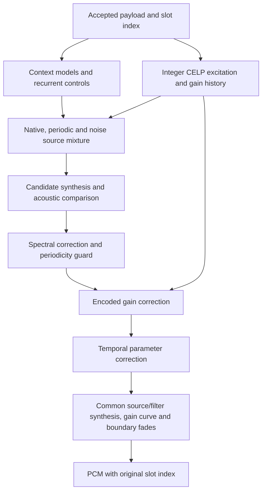

# jr_conventional_voice 1.3.0

English | [日本語](README.ja.md)

Pure Rust Modified RL-CELP speech synthesis. The decoder turns accepted, indexed CELP
payloads into PCM by combining fixed learned parameter models with stateful signal
processing. It predicts the sound's level, periodicity, pitch, and spectral
envelope, synthesizes candidate waveforms, and selects the candidate that best
matches the predicted acoustic targets across adjacent frames.

## Input, output, and processing units

The receiver performs demodulation, synchronization, channel decoding, and FEC/CRC
acceptance before calling this crate. The input here is an accepted speech payload
or an explicit missing/nonvoice slot, with a `u32` slot index.

| Item | Representation |
|---|---|
| Input frame | 158 bits packed LSB-first into 20 bytes; the top two bits of byte 19 must be zero |
| Frame duration | 40 ms |
| Output frame | 320 `i16` samples, 8 kHz, mono, with the original slot index |
| Spectral processing | Two 20 ms halves, each with its own spectral envelope |
| Excitation and level processing | Four 10 ms blocks of 80 samples |
| Continuous-input lookahead | Seven frames, 280 ms in total |

The 20 ms and 10 ms units organize synthesis within a 40 ms input frame. State is
shared across these units and across consecutive frames. The bit groupings and
codeword interpretations used to build model features describe this implementation;
they do not establish a complete normative Modified RL-CELP bit allocation.

## Overall signal path

Speech is represented by an **excitation signal** and a **spectral envelope**.
Excitation controls the periodic pulse/noise character; the envelope shapes its
frequency content. Level and pitch controls determine how that sound evolves over
time. Fixed learned models infer these controls and acoustic targets from the
payload and its context. The waveform itself is produced by the synthesis stages.



All model coefficients are compiled into the crate. Inference uses fixed tables,
linear transforms, small neural networks, and recurrent state. Some weights are
stored as quantized integers with scale factors; signal processing and model
activations primarily use `f32`. Model weights remain fixed during decoding, while
per-stream histories change as frames arrive.

### 1. Extract features and predict synthesis controls

[`predictor.rs`](src/predictor.rs) unpacks the 158 bits and regroups them into two
79-bit feature groups corresponding to the frame's halves. Table lookups and
pitch-related fields produce 40 summary features. Adding a signed representation
of every input bit gives a **198-element feature record**.

A linear predictor uses a seven-frame window, from three preceding to three
following frames. Small multilayer networks refine spectral and level estimates
using nearby feature records. A **64-state gated recurrent unit (GRU)** carries
information from earlier predictions and predicts residual adjustments. Reflection
coefficients are bounded and converted into a cepstral representation of the
spectral envelope. Local pitch stabilization and bounded refinements then adjust
spectral shape and pitch using neighboring blocks and payload categories.

The result is an internal **82-element control vector**:

| Controls | Purpose |
|---|---|
| Four level values | Target level for each 10 ms block |
| Frame-level voicing and period | Context for calibration and refinement |
| Two sets of 32 cepstral coefficients | Spectral envelopes for the two 20 ms halves |
| Four periodicity controls | Pulse/noise balance for each 10 ms block |
| Four pitch periods | Excitation period in samples, constrained to 20–160 samples |
| Four additional level-slope values | Inputs to within-block gain shaping; initialized to zero in this path |

At a segment boundary or EOF, unavailable context is supplied by the nearest
available feature record. Short calls can therefore be flushed without waiting
for a full context window.

### 2. Correct gain and spectral shape

[`correction.rs`](src/correction.rs) adjusts the predicted controls using payload
categories and their recent history. Gain correction combines code-dependent
values, four recent gain categories, and acoustic controls. Gates reduce correction
in quiet regions and limit positive gain changes near high signal levels.

Spectral correction combines code-dependent tables, recent spectral categories,
and a small quantized neural network. Corrections are bounded in both coefficient
space and their frequency-domain effect before they are added to the envelope.
These steps change synthesis parameters before waveform generation.

### 3. Reconstruct excitation and its state

The implementation in [`src/celp/`](src/celp/) reuses and adapts parts of
[mcelp-codec](https://github.com/soltia48/mcelp-codec), including the integer DSP
code and tables in [`fixed_core/`](src/celp/fixed_core/). These are integrated with
Modified RL-CELP parameter decoding and gain/spectral state handling. The reused
code is Copyright (c) 2026 KIRISHIKI Yudai, licensed under the MIT License; the
original notice and license text are retained in [`src/celp/LICENSE`](src/celp/LICENSE).

[`celp/`](src/celp/) interprets two parameter groups and runs an
integer CELP core. Adaptive-codebook pitch memory and sparse innovation pulses
produce four 80-sample excitation blocks. Spectral lookup and interpolation,
predictive gain history, saturation, and synthesis-filter state continue across
frames. Gain history starts from the mean of the log-gain table after a reset.
The reconstructed waveform and internal gain quantities are observations for the
following models; their interpretations remain implementation hypotheses where
the bit allocation is uncertain.

[`excitation.rs`](src/excitation.rs) whitens the excitation with an order-10
prediction filter and normalizes each block. It also constructs a coherent periodic
source from current and delayed excitation, and deterministic noise. These three
sources retain their own histories. No recording or reference waveform is needed
during decoding.

### 4. Infer a source mixture and choose a synthesis trajectory

[`source_features.rs`](src/source_features.rs) combines recent payload and physical
features into 570 values per 20 ms half. Native waveform descriptors, controls,
and source geometry extend this to **633 values**. A **633→256→128→40** network
predicts bounded spectral/level corrections and source-mixture adjustments.
The mixture weights are normalized and smoothed; block power is normalized again
after mixing.

The decoder compares the proposed source's periodicity with an ordinary pulse/noise
trial. If the proposal has weak periodicity and the ordinary trial is substantially
stronger, that frame uses the ordinary controls and source. This rule applies to
all received content.

[`planner.rs`](src/planner.rs) uses the acoustic targets from
[`plan_features.rs`](src/plan_features.rs) and [`plan_target.rs`](src/plan_target.rs).
Those models infer block levels, spectral-band shape, periodicity, and pitch-error
costs from a 220-element feature vector. Three current-frame candidates and nine
next-frame trials test the effect of changing the pulse/noise balance. Explicit
source blocks are shared among trials; those blocks can therefore make different
actions equivalent. Only the selected current state is committed.

[`plan_acoustics.rs`](src/plan_acoustics.rs) measures actual trial PCM: integer-sum
correlations at lags 20–160, Hann-windowed spectral-band levels, four block energies,
and saturation. It also scores overlapping 80 ms windows when history is available.
The current cost plus the best next-frame cost determines the choice. A fixed
margin protects the default choice, which is always used at the start of a run.
The original-source trial and the selected-source synthesis each keep independent
state and one frame of lookahead.

### 5. Correct spectrum and gain before final synthesis

Selected and native PCM descriptors plus run age extend the observation to
**679 values per half**. A **679→384→192→34** network refines spectral shape.
A trial synthesizer checks whether the refinement loses periodicity that the
selected waveform had retained; if so, the earlier controls are used for that frame.
This check maintains its own continuous trial history.

A further baseline synthesis measures actual level with whole-frame level
restoration disabled. Its level residuals, the requested levels, and the integer
core's gain history extend the observation to **707 values**. A fixed linear
gain model consumes the last 137 values to estimate two block-gain corrections
per half, at half strength.

The temporal model embeds each 707-element observation into 128 values. For each
half it combines four past halves, the current half, and two future halves:
**896→256→128→34**. Context clamps to the nearest available half at a run boundary.
This model adjusts spectrum and block gains at half strength. Spectral changes
are bounded in coefficient and frequency-response space; final gain changes are
bounded to ±12 dB and target levels to −120…−3 dB.

[`synthesis_parameters.rs`](src/synthesis_parameters.rs) interpolates block gain at
80-sample spacing with a cosine curve. Neighboring gain nodes are used only within
the same continuous run. This curve is applied inside synthesis before peak
limiting; whole-frame level restoration is disabled so it cannot undo the gain
correction.

### 6. Synthesize all received content through one path

[`vocoder.rs`](src/vocoder.rs) filters the selected excitation using
normalized, minimum-phase 128-tap responses derived from the two cepstral envelopes.
It retains excitation history, spectral smoothing, phase, and power memory across
frames. Within-block gain slopes, power normalization, the inferred gain curve,
peak limiting, and round-to-nearest-even quantization produce PCM16. Boundary
fades use 80 samples.

Speech, passenger broadcast chimes, and call channel chimes use this same pipeline.
There is no chime classifier, separate melody generator, sinusoidal chime bank,
or speech/chime crossfade. Model coefficients are fixed during decoding; only
per-stream state changes. All coefficients and tables are packaged with the crate;
inference needs neither a GPU nor an external model service.

## Lookahead, gaps, and stream state

The base predictor needs three future frames. Two source-selection stages add
one frame each, temporal correction adds one, and gain interpolation adds one.
The complete path therefore needs **seven future frames (280 ms)**. With continuous
input starting at index 0, accepting index 7 releases output index 0. Processing
time and any playback buffer are additional to this algorithmic delay.

[`stream.rs`](src/stream.rs) maintains bounded queues. At a gap, it drains the old
run, applies boundary fades, and resets all predictor, codebook, gain, noise,
filter, candidate, and temporal state before the next run. Missing-slot operations
can advance buffered work. A regular input operation emits at most one output;
`flush()` drains every accepted tail frame, including calls shorter than the
lookahead, and is idempotent. The input queue holds eight payloads; output capacity
is 16 frames. Memory use does not grow with the duration of a call.

Missing slots produce no replacement PCM. Outputs retain their original indices,
so the host can preserve gaps on its timeline. A new index epoch requires a fresh
`Voice` or `jr_voice_reset`. Each independent channel needs its own state; immutable
coefficients are shared. The C ABI number and frame representation remain unchanged.

## API usage

The safe Rust interface is [`receiver::Voice`](src/receiver.rs). Input indices must
strictly increase across both accepted and missing slots. Drain `read()` after each
`push()` and after `flush()`. Undrained output prevents the next input from being
accepted. Invalid payloads and index-order errors do not consume a slot; an internal
synthesis failure retires the decoder until it is reinitialized.

```rust
use jr_conventional_voice::receiver::{Output, Voice};

pub fn decode(
    slots: impl IntoIterator<Item = (u32, Option<[u8; 20]>)>,
) -> Result<Vec<Output>, String> {
    let mut voice = Voice::default();
    let mut output = Vec::new();
    for (index, payload) in slots {
        voice.push(index, payload)?;
        while let Some(frame) = voice.read() {
            output.push(frame);
        }
    }
    voice.flush()?;
    while let Some(frame) = voice.read() {
        output.push(frame);
    }
    Ok(output)
}
```

Pass `Some(payload)` for an accepted frame and `None` for a rejected or nonvoice
slot. Each `Output` contains `index` and `pcm: [i16; 320]`. A streaming caller can
consume each output immediately instead of collecting it in a vector.

The [C header](include/jr_voice.h) defines **ABI 2**. `jr_voice_process` supplies a
payload; `jr_voice_advance` supplies a missing slot. Drain `jr_voice_read` after
these calls and after `jr_voice_flush`. Each successful read writes the original
index and exactly 640 little-endian PCM bytes. Calls on a handle require exclusive,
serialized access.

| Stream-operation result | Meaning |
|---|---|
| `0` | Success; for `jr_voice_read`, no output is available |
| `1` from `jr_voice_read` | One output frame was copied |
| `-1` | Invalid argument or payload |
| `-2` | Invalid stream state or index order |
| `-3` | Pending output must be read first |
| `-4` | Internal failure; reset is required |

`jr_voice_status` exposes completion/failure flags, frame counts, and processing
times in a 28-byte structure. `jr_voice_version()` reports `1.3.0`. The Cargo
library target is an `rlib`; the header documents the exported C entry points.

## Source layout and tests

The signal path is coordinated by [`synthesis.rs`](src/synthesis.rs).
Model loading and fixed inference kernels are in [`synthesis_models.rs`](src/synthesis_models.rs),
with model data stored as `.bin` files in [`src/models/`](src/models/).
[`models.rs`](src/models.rs) and [`model_bindings/`](src/model_bindings/) provide
array types, dimensions, and byte offsets for the predictor, correction, and planner
tables. Their little-endian values are decoded at compile time; float bits and
quantized integers are preserved without alignment-dependent casts. Indices use
32-bit unsigned values on disk, independent of the host's pointer width.

The source, spectrum, gain, and temporal network files contain named float arrays
with dimensions. They are loaded once and shared by decoder instances. CELP parameter
tables are in `celp_parameters.bin`. All assets are embedded with `include_bytes!`;
no external model files are needed at runtime.

The files linked in the stages above separate feature extraction, integer CELP
state, acoustic selection, parameter correction, and synthesis.

```sh
cargo test -p jr_conventional_voice --locked
cargo clippy -p jr_conventional_voice --all-targets --locked -- -D warnings
```

Tests generate payloads in memory. They cover ABI validation/backpressure, seven-frame
lookahead, future-dependency bounds, repeated gaps, short-call tails, state isolation,
maximum indices, deterministic noise, and idempotent flushing. No captured audio or
radio fixtures are packaged. These are contract and numerical tests; acoustic target
scores used inside the decoder are not direct measures of intelligibility.
