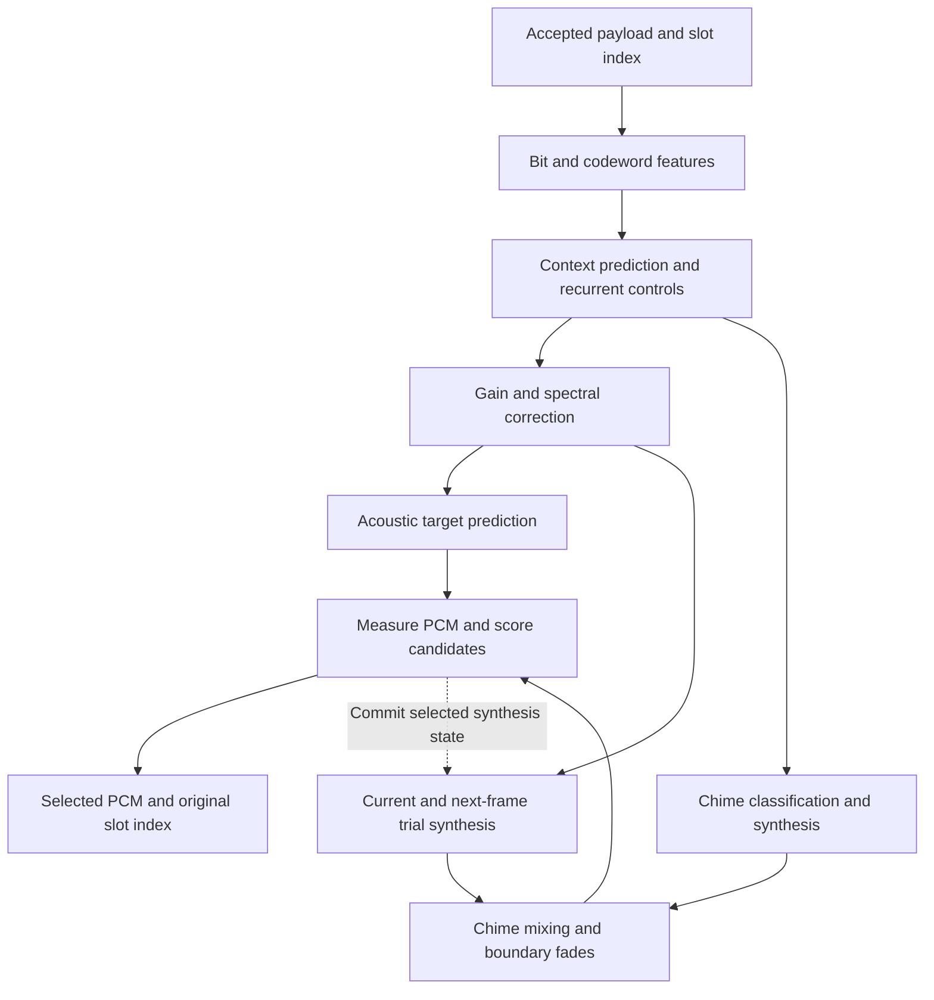

# jr_conventional_voice 1.2.0

English | [日本語](README.ja.md)

Pure Rust Modified RL-CELP speech synthesis. The decoder turns accepted, indexed CELP
payloads into PCM by combining fixed learned parameter models with stateful signal
processing. It predicts the sound's level, periodicity, pitch, and spectral
envelope, synthesizes candidate waveforms, and selects the candidate that best
matches the predicted acoustic targets across adjacent frames.

## Input, output, and processing units

The receiver performs demodulation, synchronization, channel decoding, and FEC/CRC
acceptance before calling this crate. The input here is an accepted speech payload
or an explicit missing/nonvoice slot, with a `u32` slot index.

| Item | Representation |
|---|---|
| Input frame | 158 bits packed LSB-first into 20 bytes; the top two bits of byte 19 must be zero |
| Frame duration | 40 ms |
| Output frame | 320 `i16` samples, 8 kHz, mono, with the original slot index |
| Spectral processing | Two 20 ms halves, each with its own spectral envelope |
| Excitation and level processing | Four 10 ms blocks of 80 samples |
| Continuous-input lookahead | Four frames, 160 ms in total |

The 20 ms and 10 ms units organize synthesis within a 40 ms input frame. State is
shared across these units and across consecutive frames. The bit groupings and
codeword interpretations used to build model features describe this implementation;
they do not establish a complete normative Modified RL-CELP bit allocation.

## Overall signal path

Speech is represented by an **excitation signal** and a **spectral envelope**.
Excitation controls the periodic pulse/noise character; the envelope shapes its
frequency content. Level and pitch controls determine how that sound evolves over
time. Fixed learned models infer these controls and acoustic targets from the
payload and its context. The waveform itself is produced by the synthesis stages.



All model coefficients are compiled into the crate. Inference uses fixed tables,
linear transforms, small neural networks, and recurrent state. Some weights are
stored as quantized integers with scale factors; signal processing and model
activations primarily use `f32`. Model weights remain fixed during decoding, while
per-stream histories change as frames arrive.

### 1. Extract features and predict synthesis controls

[`predictor.rs`](src/predictor.rs) unpacks the 158 bits and regroups them into two
79-bit feature groups corresponding to the frame's halves. Table lookups and
pitch-related fields produce 40 summary features. Adding a signed representation
of every input bit gives a **198-element feature record**.

A linear predictor uses a seven-frame window, from three preceding to three
following frames. Small multilayer networks refine spectral and level estimates
using nearby feature records. A **64-state gated recurrent unit (GRU)** carries
information from earlier predictions and predicts residual adjustments. Reflection
coefficients are bounded and converted into a cepstral representation of the
spectral envelope. Local pitch stabilization and bounded refinements then adjust
spectral shape and pitch using neighboring blocks and payload categories.

The result is an internal **82-element control vector**:

| Controls | Purpose |
|---|---|
| Four level values | Target level for each 10 ms block |
| Frame-level voicing and period | Context for calibration and refinement |
| Two sets of 32 cepstral coefficients | Spectral envelopes for the two 20 ms halves |
| Four periodicity controls | Pulse/noise balance for each 10 ms block |
| Four pitch periods | Excitation period in samples, constrained to 20–160 samples |
| Four additional level-slope values | Inputs to within-block gain shaping; initialized to zero in this path |

At a segment boundary or EOF, unavailable context is supplied by the nearest
available feature record. Short calls can therefore be flushed without waiting
for a full context window.

### 2. Correct gain and spectral shape

[`correction.rs`](src/correction.rs) adjusts the predicted controls using payload
categories and their recent history. Gain correction combines code-dependent
values, four recent gain categories, and acoustic controls. Gates reduce correction
in quiet regions and limit positive gain changes near high signal levels.

Spectral correction combines code-dependent tables, recent spectral categories,
and a small quantized neural network. Corrections are bounded in both coefficient
space and their frequency-domain effect before they are added to the envelope.
These steps change synthesis parameters before waveform generation.

### 3. Predict the acoustic targets used for selection

[`plan_features.rs`](src/plan_features.rs) builds a separate **220-element feature
vector** from the corrected controls and the payload. It contains current control
summaries, differences from the previous frame, smoothed histories, spectral and
gain features, and codeword-derived excitation summaries. The latter include
energy, short-lag correlations, and pulse-class indicators.

[`plan_target.rs`](src/plan_target.rs) predicts what the synthesized PCM should
measure like: four block levels, 20 spectral-band levels for each half, periodicity,
and evidence for a measurable pitch. It also predicts pitch distributions used to
assign a cost to each candidate lag from 20 to 160 samples. The cumulative
distributions are made monotonic before conversion to expected pitch-error costs.
A small neural network refines the current frame's periodicity target.

Targets cover the current 40 ms frame and two overlapping 80 ms windows. These
longer windows include preceding PCM and help evaluate continuity across frame
boundaries. All targets come from payload features, controls, and decoder history.

### 4. Synthesize a candidate waveform

[`vocoder.rs`](src/vocoder.rs) generates the waveform in four 80-sample blocks.
Pitch controls the spacing of a phase-continuous pulse train. A stateful,
fixed-seed pseudorandom generator supplies noise. The periodicity control is
mapped and smoothed, then used to mix pulse and noise excitation.

Each 20 ms envelope is converted into a normalized minimum-phase impulse response
by [`numeric.rs`](src/numeric.rs). A 128-tap FIR shapes the excitation. Excitation
history, pulse phase, spectral history, and power estimates persist across blocks
and frames. Gain ramps and smoothed power normalization set the requested level;
peak limiting and round-to-nearest-even conversion produce PCM16 samples.

Candidate selection varies the periodicity control `v` using three curves:

```text
v' = 1 - (1 - v)^a,     a in {0.5, 1, 2}
```

These choices weaken, retain, or strengthen periodic excitation. One curve is
applied to all four blocks of a candidate frame; pitch, level, and envelope controls
remain those supplied to the synthesizer. A local voicing policy provides the
default choice against which the candidate score improvement is compared.

### 5. Score current and future candidates

[`planner.rs`](src/planner.rs) copies the current synthesis state and creates
**three current-frame candidates**. For each resulting state, it creates three
next-frame candidates: **nine future trials** in total. This lets the selection
account for how today's phase, filtering, and gain state affect the next frame.

[`plan_acoustics.rs`](src/plan_acoustics.rs) measures the actual mixed PCM:

- Mean-centered correlation over lags 20–160 measures periodicity and pitch.
  Correlation sums use integer accumulation before floating-point normalization.
- Each 20 ms half is Hann-windowed, transformed with a 512-point FFT, and reduced
  to 20 spectral bands. Absolute band levels and level-independent shape are scored.
- Four 10 ms energy measurements evaluate level errors. Saturated samples add a
  penalty, and missing pitch is penalized according to the predicted pitch evidence.
- When enough history exists, periodicity and pitch are also evaluated over two
  80 ms windows: the previous-plus-current frame, and a window centered on the
  previous frame extending 20 ms into each neighbor.

The selection rule is:

```text
score(current choice) = current-frame cost
                      + minimum next-frame cost from that choice's resulting state
```

The default voicing choice is retained unless the best candidate improves this
score by more than the configured margin. The first frame of a segment always
uses the default choice. Only the chosen current frame and its synthesis state
are committed; future trials are discarded and reconsidered when more input
arrives. At EOF, the final pending frame is scored without a future-frame term.

### 6. Handle chimes and transitions

[`chime.rs`](src/chime.rs) identifies chimes for passenger broadcasts and call
channels using features from neighboring frames, a learned gate, and pattern
evidence. For passenger broadcast chimes, synthesis adjusts the level and envelope
and uses fully periodic excitation. For call channel chimes, synthesis estimates
amplitudes for a bank of sinusoidal components and a shaped-noise component.

The chime signal is mixed with speech using 40-sample transition ramps. Gaps between
accepted speech runs use 80-sample boundary fades. Both are applied **before
candidate scoring**, so selection evaluates the PCM that will actually be emitted.

## Lookahead, gaps, and stream state

The predictor needs **three future frames (120 ms)**. Candidate selection needs
the next predicted frame, adding **one more frame (40 ms)**. For continuous input
starting at index 0, the first output, index 0, becomes available when index 4 has
been accepted. Thereafter, each accepted contiguous frame normally releases one
output. This is 160 ms of synthesis lookahead, separate from processing time and
the receiver's 440 ms monitor jitter buffer.

[`stream.rs`](src/stream.rs) maintains a bounded queue and separates continuous
runs by their slot indices. A missing-slot notification can release pending work.
The final buffered control is retained until a following accepted frame or EOF
determines how to finish the run. At an accepted-index gap, pending audio is drained
and the predictor, correction, chime, and planner states are reset before synthesis
of the new run. Each regular input operation emits at most one output frame;
`flush()` drains the remaining run and can return several frames.

Outputs retain their original indices. Missing slots produce no replacement PCM;
the caller uses index gaps to preserve silence or manage its playback/recording
timeline. `flush()` is idempotent and ends the stream. Reception restart or a new
index epoch requires a fresh `Voice` (or `jr_voice_reset` through the C ABI).
Each independently received channel needs its own decoder state; coefficients are
immutable and shared.

## API usage

The safe Rust interface is [`receiver::Voice`](src/receiver.rs). Input indices must
strictly increase across both accepted and missing slots. Drain `read()` after each
`push()` and after `flush()`. Undrained output prevents the next input from being
accepted. Invalid payloads and index-order errors do not consume a slot; an internal
synthesis failure retires the decoder until it is reinitialized.

```rust
use jr_conventional_voice::receiver::{Output, Voice};

pub fn decode(
    slots: impl IntoIterator<Item = (u32, Option<[u8; 20]>)>,
) -> Result<Vec<Output>, String> {
    let mut voice = Voice::default();
    let mut output = Vec::new();
    for (index, payload) in slots {
        voice.push(index, payload)?;
        while let Some(frame) = voice.read() {
            output.push(frame);
        }
    }
    voice.flush()?;
    while let Some(frame) = voice.read() {
        output.push(frame);
    }
    Ok(output)
}
```

Pass `Some(payload)` for an accepted frame and `None` for a rejected or nonvoice
slot. Each `Output` contains `index` and `pcm: [i16; 320]`. A streaming caller can
consume each output immediately instead of collecting it in a vector.

The [C header](include/jr_voice.h) defines **ABI 2**. `jr_voice_process` supplies a
payload; `jr_voice_advance` supplies a missing slot. Drain `jr_voice_read` after
these calls and after `jr_voice_flush`. Each successful read writes the original
index and exactly 640 little-endian PCM bytes. Calls on a handle require exclusive,
serialized access.

| Stream-operation result | Meaning |
|---|---|
| `0` | Success; for `jr_voice_read`, no output is available |
| `1` from `jr_voice_read` | One output frame was copied |
| `-1` | Invalid argument or payload |
| `-2` | Invalid stream state or index order |
| `-3` | Pending output must be read first |
| `-4` | Internal failure; reset is required |

`jr_voice_status` exposes completion/failure flags, frame counts, and processing
times in a 28-byte structure. `jr_voice_version()` reports `1.2.0`. The Cargo
library target is an `rlib`; the header documents the exported C entry points.

## Source layout and tests

| Source | Responsibility |
|---|---|
| [`predictor.rs`](src/predictor.rs) | Payload features, context models, recurrent controls, pitch refinement |
| [`correction.rs`](src/correction.rs) | Gain and spectral corrections conditioned on bits and history |
| [`plan_features.rs`](src/plan_features.rs), [`plan_target.rs`](src/plan_target.rs) | Features and predicted acoustic targets for candidate selection |
| [`vocoder.rs`](src/vocoder.rs), [`numeric.rs`](src/numeric.rs) | Stateful excitation, envelope filtering, normalization, numeric bounds |
| [`plan_acoustics.rs`](src/plan_acoustics.rs), [`planner.rs`](src/planner.rs) | PCM measurement, candidate search, synthesis-state selection |
| [`chime.rs`](src/chime.rs) | Chime detection, synthesis, and transitions |
| [`stream.rs`](src/stream.rs), [`receiver.rs`](src/receiver.rs), [`lib.rs`](src/lib.rs) | Indexed scheduling, safe Rust API, C ABI |
| [`src/models/`](src/models/) | Fixed coefficients, lookup tables, and measurement constants |

From the repository root:

```sh
cargo test -p jr_conventional_voice --locked
cargo clippy -p jr_conventional_voice --all-targets --locked -- -D warnings
```

[`tests/planner.rs`](tests/planner.rs) generates synthetic payloads in memory to
check lookahead, short calls, missing slots, gaps, maximum `u32` indices, and
idempotent flushing. [Unit tests](src/tests.rs) cover C ABI backpressure, invalid
input, reset, failure retirement, numeric bounds, and deterministic noise
sequences. These tests check API and stream behavior; they do not measure speech
fidelity. The acoustic scores used during decoding guide candidate selection and
are not a direct measurement of intelligibility.
